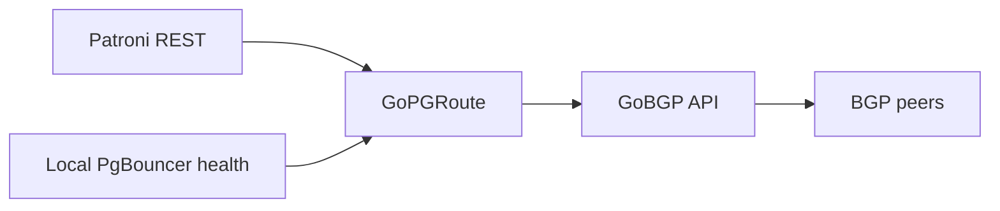

  <strong>GoPGRoute</strong> 
  Patroni-aware PostgreSQL route adapter for GoBGP

  
  

GoPGRoute is a standalone adapter project for announcing and withdrawing
PostgreSQL service prefixes through GoBGP according to Patroni and local
PgBouncer health.

**Status: internal health and route-ownership libraries, no runtime release.**
Bounded Patroni probes, a fail-closed intent policy and a journaled GoBGP
actuator are implemented and tested. The daemon, SQL pooler probe and container
images are not released. Runtime admission requires the independent T3
supervisor; an uncertain RPC is not evidence of route withdrawal.
Quality checks do not demonstrate database availability or failover.
The supported Patroni REST contract is 4.x, targeting 4.1.5; legacy 3.x
`role=master` responses do not authorize an intent.

## Intended behavior

- Advertise a write prefix only when Patroni reports an eligible primary and
  the local pooler is healthy.
- Advertise a read prefix only for an eligible replica within its configured
  lag bound and with a healthy local pooler.
- Withdraw owned paths on unknown, unhealthy or stale state. Reconcile startup
  state and periodic observations; callbacks only accelerate reconciliation.
- Change only explicitly owned prefixes and path identifiers.
- Bound withdrawal when the adapter crashes or stalls while GoBGP stays alive;
  validate supervisor and peer graceful-restart behavior independently.

Patroni, its DCS and watchdog own promotion and fencing. Route withdrawal does
not prove that an old primary can no longer accept writes.

## Architecture

## Documentation

| Document | Purpose |
|---|---|
| [Architecture](docs/en/01-architecture.md) | Safety boundaries and acceptance criteria |
| [Health contract](docs/en/02-health-contract.md) | Bounded probes and intent semantics |
| [ADR 0001](docs/en/adr/0001-bounded-health-intent.md) | Health before route actuation |
| [Route ownership](docs/en/03-route-ownership.md) | UUID authority, durable states and recovery limits |
| [ADR 0002](docs/en/adr/0002-durable-route-ownership.md) | Explicit uncertainty before supervised runtime |
| [Implementation tracks](docs/en/implementation-plan.md) | Track dependencies and exit evidence |
| [Russian documentation](docs/ru/README.md) | Russian project entry point |
| [Naming](docs/standards/naming.md) | Repository, module and binary identifiers |
| [Contributing](CONTRIBUTING.md) | Review and development workflow |
| [Security](SECURITY.md) | Private vulnerability reporting |

## Repository layout

The layout follows [GoBFD](https://github.com/dantte-lp/gobfd), adapted to this
project. `internal/health` owns the Patroni probe and intent policy;
`internal/gobgp` owns the private Unix RPC actuator and durable UUID journal. `tools`
isolates pinned development tools from runtime dependencies. `docs/en`,
`docs/ru` and `.github` contain contracts and quality workflows. Subsequent
tracks add `cmd`, `configs`, `deployments` and native integration tests when
their implementations are available. Public APIs require an actual consumer.

## Development

Install Podman and Make, then run `make verify`. All Go commands execute in a
digest-pinned Go 1.27.3 Debian Trixie image with two CPU and a 2 GiB memory
limit. Checks include race tests, vet, format, lint, module tidiness and
vulnerability analysis. Runtime dependencies pin GoBGP 4.10.0 and gRPC 1.85.0;
native tests start an isolated speaker without BGP peers or a TCP/179 listener.

## License

[Apache License 2.0](LICENSE).
