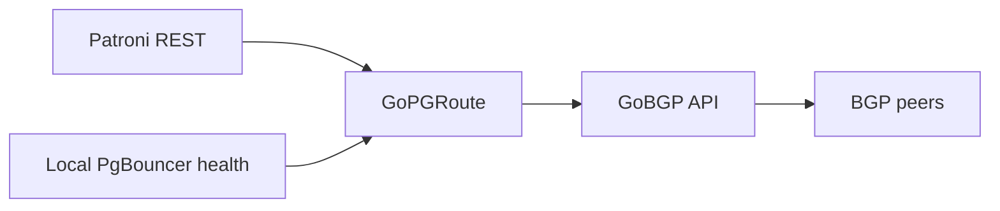

  <strong>GoPGRoute</strong> 
  Patroni-aware PostgreSQL route adapter for GoBGP

  
  

GoPGRoute is a standalone adapter project for announcing and withdrawing
PostgreSQL service prefixes through GoBGP according to Patroni and local
PgBouncer health.

**Status: design and repository bootstrap.** The daemon, CLI, packages and
container images are not implemented or released. Repository checks validate
bootstrap files; they do not demonstrate database availability or failover.

## Intended behavior

- Advertise a write prefix only when Patroni reports an eligible primary and
  the local pooler is healthy.
- Advertise a read prefix only for an eligible replica within its configured
  lag bound and with a healthy local pooler.
- Withdraw owned paths on unknown, unhealthy or stale state. Reconcile startup
  state and periodic observations; callbacks only accelerate reconciliation.
- Change only explicitly owned prefixes and path identifiers.
- Bound withdrawal when the adapter crashes or stalls while GoBGP stays alive;
  validate supervisor and peer graceful-restart behavior independently.

Patroni, its DCS and watchdog own promotion and fencing. Route withdrawal does
not prove that an old primary can no longer accept writes.

## Architecture

## Documentation

| Document | Purpose |
|---|---|
| [Architecture](docs/en/01-architecture.md) | Safety boundaries and acceptance criteria |
| [Russian documentation](docs/ru/README.md) | Russian project entry point |
| [Naming](docs/standards/naming.md) | Repository, module and binary identifiers |
| [Contributing](CONTRIBUTING.md) | Review and development workflow |
| [Security](SECURITY.md) | Private vulnerability reporting |

## Repository layout

The layout follows [GoBFD](https://github.com/dantte-lp/gobfd), adapted to this
project. `docs/en`, `docs/ru`, `.github` and project policy files exist now.
Implementation adds `cmd`, `internal`, `configs`, `deployments`, `test` and
`tools` with their first real contents. Public `api` and generated `pkg`
packages require an actual API decision.

## License

[Apache License 2.0](LICENSE).
